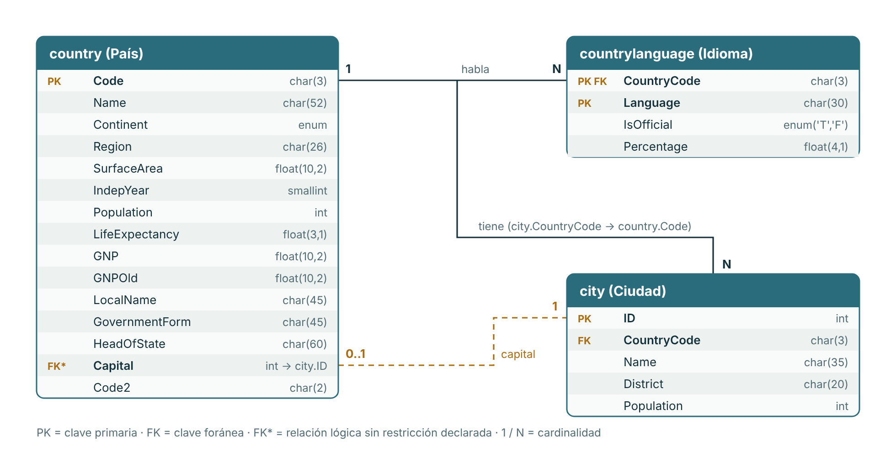

# Atlas de ciudades

Aplicación web responsive (computador, tablet y teléfono) para consultar, por país, **las ciudades disponibles y su población**, con el **Top 10 de las más pobladas** y el **Top 10 de las menos pobladas**.

Desarrollada para la prueba técnica **Analista de Soporte Nivel 1 – Infodec**, sobre la base de datos de ejemplo **World** de MySQL.

---

## Funcionalidades

**Requeridas (Pantalla 1)**

- Campo de selección (obligatorio) con todos los países de la base de datos, agrupados por continente.
- Al seleccionar un país se muestran sus ciudades y la población de cada una.
- Ranking en escala de 10: las 10 ciudades más pobladas y las 10 menos pobladas.

**Adicionales**

- Datos del país: población total, número de ciudades registradas, % de la población que vive en esas ciudades y capital.
- Idiomas que se hablan en el país, con su porcentaje y si son oficiales.
- Clima actual de la capital (API pública Open-Meteo, sin API key).
- Tabla completa con búsqueda (sin importar tildes ni mayúsculas) y ordenamiento por columna.
- API JSON de solo lectura para integraciones y pruebas en Postman.
- Modo oscuro automático, navegación por teclado y diseño adaptable a móvil.
- Manejo de errores: mensajes claros si la BD no responde o si el país no existe.

## Tecnologías

| Capa | Tecnología |
|---|---|
| Base de datos | MySQL 5.7+/8.x o MariaDB 10.x (base `world`) |
| Backend | PHP 8.0+ con patrón MVC propio (sin dependencias externas) |
| Acceso a datos | PDO con sentencias preparadas |
| Frontend | HTML5, CSS3 (Grid/Flexbox), JavaScript sin librerías |
| Control de versiones | Git + GitHub |

## Arquitectura (MVC)

```
Navegador ─► public/index.php (front controller)
                │
                ▼
           Core/Router ──► Controllers/HomeController ──► Views/home.php (HTML)
                │          Controllers/ApiController  ──► JSON
                ▼
           Services/CountryReport  (lógica de negocio compartida)
                │
                ▼
           Models/Country · City · CountryLanguage ──► Core/Database (PDO) ──► MySQL world
```

- **Modelo**: consultas SQL a cada tabla (`app/Models`).
- **Vista**: plantillas PHP que solo presentan datos y escapan todo lo que imprimen (`app/Views`).
- **Controlador**: recibe la petición, valida parámetros y decide qué vista o JSON responder (`app/Controllers`).
- **Servicio**: arma el reporte del país una sola vez para la vista y para la API (`app/Services`).

## Estructura del proyecto

```
atlas-ciudades/
├── app/
│   ├── Controllers/      Controller base, HomeController, ApiController
│   ├── Core/             Env (.env), Database (PDO), Router
│   ├── Models/           Model base, Country, City, CountryLanguage
│   ├── Services/         CountryReport
│   ├── Views/            layouts/main.php, home.php, error.php
│   ├── bootstrap.php     Autoload PSR-4, configuración y manejo global de errores
│   └── helpers.php       e(), num(), continent_es()
├── config/config.php     Configuración leída desde .env
├── database/
│   └── consultas_pregunta2.sql
├── docs/
│   ├── diagrama_bd.md / .png / .svg
│   ├── errores_api.md
│   └── postman/Prueba_Soporte_APIs_Clima_Moneda.postman_collection.json
├── public/               Único directorio expuesto al navegador
│   ├── index.php
│   └── assets/css/app.css, assets/js/app.js
├── .env.example
└── README.md
```

## Instalación

### 1. Importar la base de datos

```bash
mysql -u root -p < world.sql
```

O desde phpMyAdmin / DBeaver / HeidiSQL: importar `world.sql` (crea la base `world`).

### 2. Configurar la conexión

```bash
cp .env.example .env
```

Editar `.env` con el usuario y la contraseña de MySQL. Se recomienda un usuario solo de lectura:

```sql
CREATE USER 'atlas'@'localhost' IDENTIFIED BY 'una_clave_segura';
GRANT SELECT ON world.* TO 'atlas'@'localhost';
```

### 3. Ejecutar

**Opción A – Servidor embebido de PHP**

```bash
php -S localhost:8000 -t public
```

Abrir http://localhost:8000

**Opción B – XAMPP / WAMP / Laragon**

Copiar la carpeta en `htdocs` y abrir `http://localhost/atlas-ciudades/public/`.

> Requiere la extensión `pdo_mysql` habilitada (viene activa en XAMPP).

## API JSON

| Método | Ruta | Respuesta |
|---|---|---|
| GET | `index.php?route=api/countries` | Lista de países con número de ciudades |
| GET | `index.php?route=api/cities&code=COL` | País, idiomas, estadísticas, Top 10 más/menos pobladas y todas las ciudades |

Códigos de estado: `200` OK · `404` país o ruta inexistente · `405` método no permitido · `422` código inválido · `500` error de base de datos.

## Seguridad

- Sentencias preparadas en todas las consultas (sin concatenar datos del usuario). El único valor dinámico en `ORDER BY` se valida contra una lista blanca.
- Validación del código de país con expresión regular (`^[A-Z]{3}$`).
- Escape de toda salida HTML con `htmlspecialchars` para prevenir XSS.
- Credenciales fuera del código (`.env` está en `.gitignore`).
- Los errores técnicos se registran en el log del servidor y solo se muestran si `APP_DEBUG=true`.

## Base de datos

Ver [docs/diagrama_bd.md](docs/diagrama_bd.md).



## Pregunta 2 – Consultas SQL

Ver [database/consultas_pregunta2.sql](database/consultas_pregunta2.sql).

## Pregunta 4 – Postman

- Colección: [docs/postman](docs/postman/Prueba_Soporte_APIs_Clima_Moneda.postman_collection.json)
- Errores documentados: [docs/errores_api.md](docs/errores_api.md)

## Versionamiento

Se usa Git con ramas por funcionalidad y mensajes de commit con la convención *Conventional Commits*:

```bash
git init
git add .gitignore .env.example config app/Core app/bootstrap.php app/helpers.php public/index.php
git commit -m "chore: estructura MVC base, router y conexión PDO"

git add app/Models app/Services
git commit -m "feat(models): modelos Country, City y CountryLanguage"

git add app/Controllers app/Views public/assets
git commit -m "feat(ui): pantalla de selección de país con Top 10 de ciudades"

git add database docs
git commit -m "docs: consultas SQL, diagrama de BD y colección Postman"

git add README.md
git commit -m "docs: README con instalación y arquitectura"

git branch -M main
git remote add origin https://github.com/<usuario>/atlas-ciudades.git
git push -u origin main
```

Prefijos usados: `feat` (funcionalidad), `fix` (corrección), `docs` (documentación), `chore` (configuración), `refactor`, `style`.

## Limitaciones conocidas

- Las cifras de población provienen de la base World de MySQL (datos históricos de referencia), no de censos actuales.
- Algunos países (por ejemplo, Antártida) no tienen ciudades registradas; la app lo indica en pantalla.
- El clima depende de la disponibilidad de Open-Meteo; si no responde, la app muestra un aviso y sigue funcionando.

## Autor

**[Tu nombre]** – Proceso de selección Analista de Soporte Nivel 1, Infodec.
