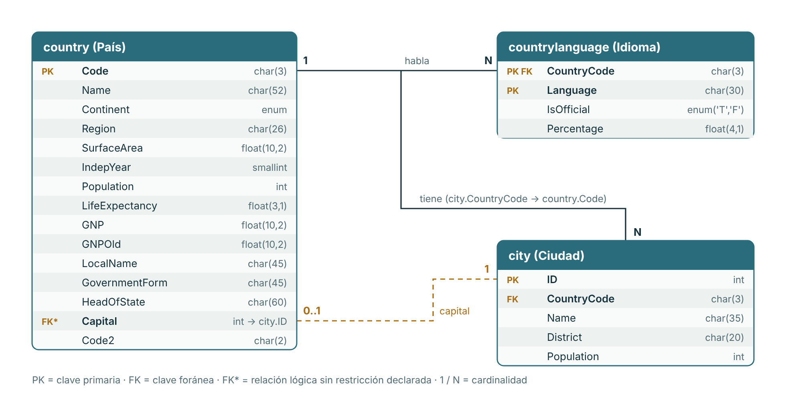
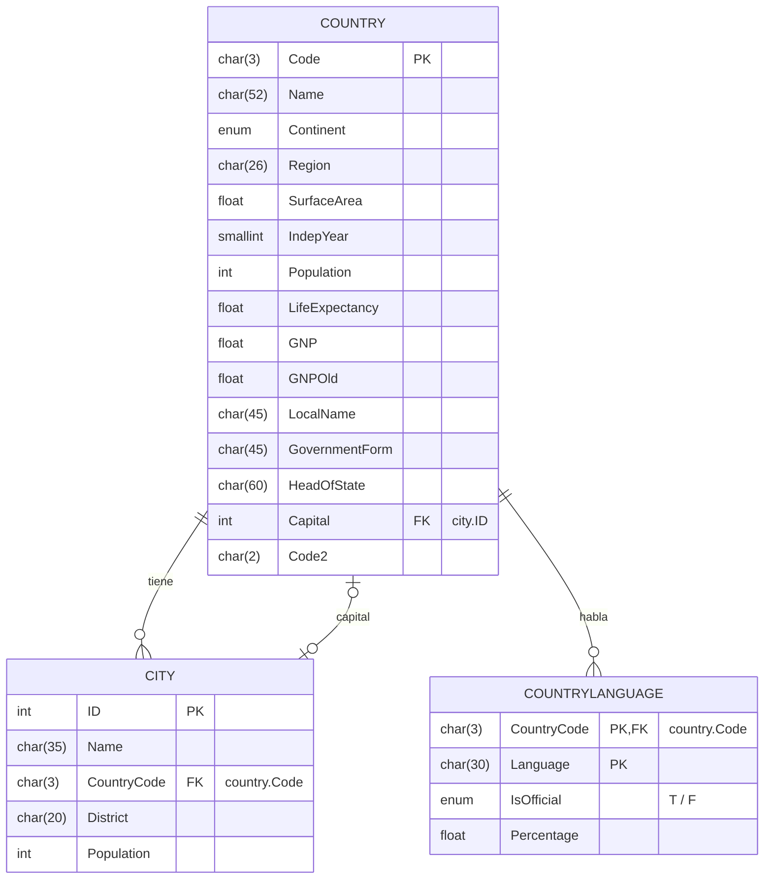

# Diagrama de la base de datos `world`

## Relaciones

| Relación | Tipo | Llave |
|---|---|---|
| country → city | 1 a muchos (un país tiene muchas ciudades; cada ciudad pertenece a un solo país) | `city.CountryCode` → `country.Code` (FK) |
| country → countrylanguage | 1 a muchos (un país habla varios idiomas) | `countrylanguage.CountryCode` → `country.Code` (FK) |
| country → city (capital) | Cada país puede tener una capital | `country.Capital` → `city.ID` (relación lógica, sin FK declarada) |

## Tablas que usa la aplicación

| Tabla | Para qué la usa la app |
|---|---|
| `country` | Llenar el selector de países y mostrar población, región y capital |
| `city` | Listar las ciudades del país, el Top 10 más y menos pobladas |
| `countrylanguage` | Mostrar los idiomas que se hablan en el país |
